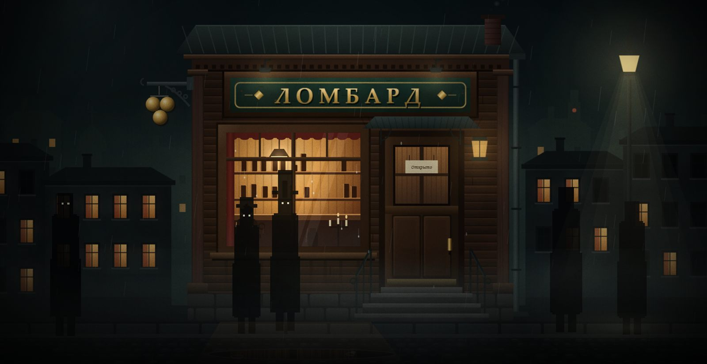
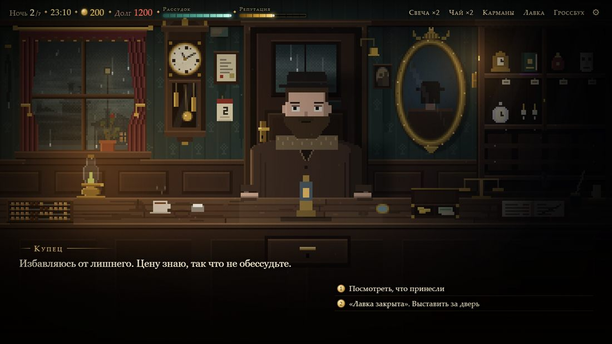
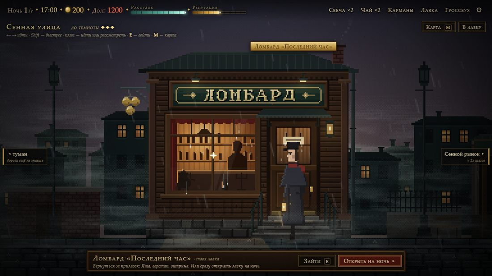
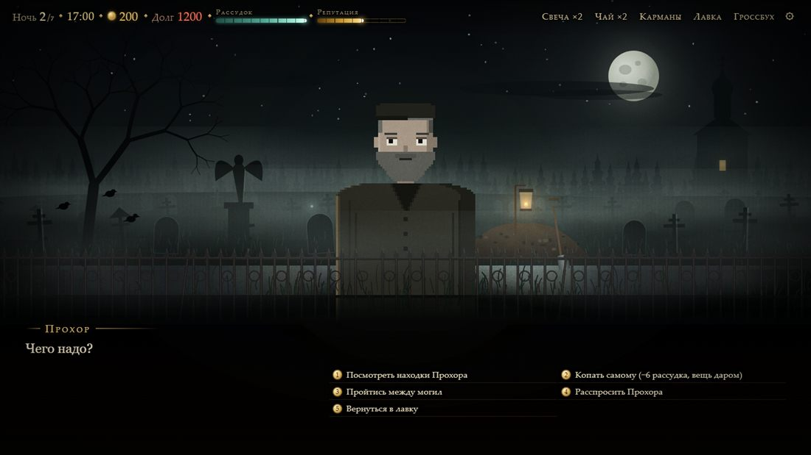
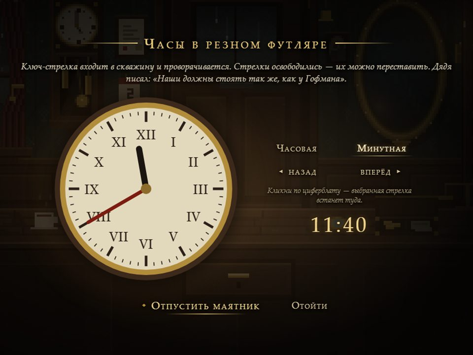

# Последний час

Хоррор о торговле в долг. Семь ночей ты держишь ломбард в городе, куда каждый вечер приходит туман, а часть покупателей давно не люди.

**[Играть в браузере](https://claude.ai/artifact/DjgxvP3vUBTs3wZRvQ5GvD)** · **[Об игре](https://claude.ai/artifact/GNryULbNvQUBZ9VTAbrHm5)**

Лучше на компьютере с мышью и в наушниках.

**Жанр:** хоррор, торговый симулятор, расследование

## Сюжет

Письмо приходит в четверг. Нотариус из Мглова сообщает, что дядя Матвей Ильич Сорин «выбыл при невыясненных обстоятельствах». Тебе отходит его лавка на Сенной и его долг Кредитору, человеку в цилиндре.

Вечером ты закупаешь товар, мастеришь и ходишь по городу. Ночью торгуешься с посетителями. Любой из них может оказаться Пустым: должником, у которого Кредитор по кусочку забрал тень, отражение, даже привычку моргать. Пустые платят щедро и настоящими деньгами. Каждая сделка с ними стоит рассудка.

Дядя оставил в гроссбухе правила. Он их нарушил.

| | |
|---|---|
|  |  |
|  |  |

## Что в игре

- Семь ночей торговли: закупка, верстак, витрина, торг с посетителями, проверка вещей лупой.
- Пустые среди покупателей. Их выдают колокольчик, тень, отражение, глаза и пламя лампы.
- Город Мглов: три улицы и семь мест, куда можно зайти до темноты.
- Расследование: улики в календаре, счетах, письмах и разговорах, тайники и головоломки в лавке.
- Восемь концовок, у каждой свой короткий ролик.

## Технологии

- HTML5, JavaScript, CSS, Canvas 2D, Web Audio API. Без движка и сторонних библиотек.
- Вся графика рисуется кодом: в игре нет ни одного файла картинки (скриншоты в папке `screenshots` нужны только для этой страницы).
- Звук тоже синтезируется в браузере: дождь, колокольчик, тиканье, благовест.
- Игра сделана в Claude Code от Anthropic, в основном на модели Opus 5.5. Идея, сеттинг и направление игры принадлежат автору, всё остальное Claude Code делал по её указаниям.

## Как запустить у себя

1. Нажмите **Code → Download ZIP** и распакуйте архив.
2. Откройте файл `index.html` в браузере (Chrome, Edge, Firefox).

Устанавливать ничего не нужно.

## Что где лежит

| Файл | Что внутри |
|---|---|
| `index.html` | Точка входа |
| `css/` | Оформление экранов и меню |
| `js/main.js` | Меню, сохранения, ход игры |
| `js/econ.js`, `js/data.js` | Экономика, товары, посетители, реплики |
| `js/art.js`, `js/hd.js`, `js/lavka.js` | Графика: пиксель-арт и детальная живопись |
| `js/intro.js`, `js/endings.js`, `js/film.js` | Вступление и ролики концовок |
| `js/story.js`, `js/quest.js`, `js/visions.js` | Сюжет, расследование, видения |
| `js/street.js`, `js/town.js`, `js/room.js` | Улицы, места в городе, осмотр лавки |
| `js/puzzles.js`, `js/pockets.js` | Головоломки и вещи в карманах |
| `js/audio.js` | Звук |
| `js/dev.js` | Отладка, в обычной игре не загружается |

## Внимание

В игре есть резкие звуки и вспышки. Скримеры отключаются в настройках.

---

© 2026. Все права на игру принадлежат автору. Код открыт для ознакомления, копировать и распространять игру без разрешения нельзя.
